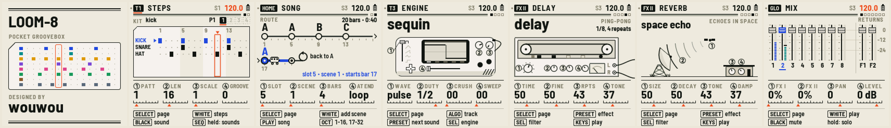

# LOOM-8 "paper": a fork of LOOM-8 for the M-VAVE FM-1

A groovebox firmware for the M-VAVE FM-1 pocket synth, with the interface redrawn as the pages of a printed service
manual, more tools for building a song, a chip-voice engine and rebuilt reverbs.



## Built on LOOM-8 by Charles Vestal

**This is a personal, unofficial fork.** LOOM-8 is [Charles Vestal's](https://github.com/charlesvestal) firmware:
the sequencer, the engines, the effects, the song, the tools and the platform under them are his work, and nearly
all of this repository is his code and his documentation. The original is at
**<https://github.com/charlesvestal/fm1-loom>**; this fork is cut from its version 0.15.1 (commit `ffc0cd1`). If you
want LOOM-8 itself, go there: it has the official releases, the web installer, the browser emulator and support.

This fork is not affiliated with or endorsed by Charles Vestal, M-VAVE or teenage engineering. The interface took
inspiration from the feel of teenage engineering's instruments; nothing of theirs is used, and the name is only used
descriptively (see `LICENSING.md`). The fork's changes are by wouwou.

## What is different

Details, with the commit for each item, are in **[CHANGES.md](CHANGES.md)**. In short:

- **A new interface**, one "paper" look in place of the three colour themes. Every page is drawn as a figure: Steps a
  punched card, Song a route map with section letters and a train at the playing position, Arrange ten punched strips,
  Mix a desk. A fixed two-column hint area at the bottom always says which control does what.
- **Machines.** Every sound engine, send effect, reverb mode and character type is an ink drawing of an imagined
  1980s machine whose own controls are the page's four knobs. The four echo reverbs are derelict Cold War signal
  stations. Envelope, Filter, LFO and Players are drawn as instruments. The LFO page is animated, and the sequencer
  card pulses coral on the beat (a setting, BEAT FLASH).
- **Song building:** NEW SECTION (a scene with its own copy of the patterns), COPY BAR and PASTE BAR for all tracks, MOVE
  SLOT, DUPLICATE SECTION, CLEAR ALL PATTERNS, two levels of undo, EUCLID HITS, EUCLID ROTATE and VARY BAR fills, and
  lists that never reopen on a destructive row.
- **Sound:** a new chip-voice engine, *sequin* (a port of Felucca-Engines' LOFI); the plate reverb rebuilt; half-band
  filters around the lush reverb and the delay; a three-voice chorus; and a fix to the PlayStation reverb modes' output
  interpolator.

Pictures of every machine: [engines](docs/img/engines.png), [effects and echo stations](docs/img/effects.png),
[character types](docs/img/characters.png).

## What was removed

Removed to make room, so nobody is surprised:

- **Bluetooth audio** and **Bluetooth MIDI devices** (keyboards and controllers the FM-1 would connect to). Bluetooth
  MIDI *with a computer, phone or tablet* is still there. Use the headphone jack or USB for audio, and a cable or USB
  for a keyboard.
- **The cane engine.** Projects and user presets that used it still load, with the nearest sound from another engine.
- **The reverb modes "studio S" and "studio L".** "Studio M" is now called "studio". Projects that used the others load
  with the studio.
- **The three colour themes and large-type mode.** There is one look.

## Install

**At your own risk.** This is firmware for a device you own, written by one person, tested on one device. `BUILDING.md` says an FM-1 that
crashes twice in a row at start-up comes up in a safe mode, and M-VAVE's firmware can be put back (below), but nobody can
promise you will never need that.

Release files are on this fork's GitHub releases page, as a `.fwsc` package, with a `-res.bin` file beside it (the 909
cymbals' samples). Download both into one folder.

**The upstream web installer cannot install this fork's file.** I checked: its page (`base/web/installer.html` in this tree)
fetches the firmware from its own site and only lets you choose a local file for M-VAVE's stock firmware. So install this
build from the command line, with the script in this repository:

```
git clone --recursive https://github.com/wouwou-dis/fm1-loom
cd fm1-loom
pip3 install mido python-rtmidi
python3 base/tools/fm1_install.py PATH/TO/THE.fwsc        # (the -res.bin beside it is written afterwards)
python3 base/tools/fm1_install.py --info                  # which firmware the connected FM-1 has
```

Connect the FM-1 by USB first. The script finds it, runs the update and checks the identity afterwards; see
`BUILDING.md` ("Install") for the details, and the manual's Troubleshooting section if it cannot find the FM-1 or
the FM-1 does not start. Before you install, you may want to back up your projects and presets: the upstream
[Backup page](https://charlesvestal.github.io/fm1-loom/backup/) or `base/tools/fm1_backup.py backup FILE --magic LM8B`
(I have not tried the upstream page against this build).

**Going back.** To official LOOM-8: open the [upstream installer](https://charlesvestal.github.io/fm1-loom/install/)
in Chrome or Edge with the FM-1 plugged in, and install from there. To M-VAVE's own firmware: the same page has "Back
to the stock firmware" (you download M-VAVE's `FM-1.fwsc` and choose it), or use M-VAVE's own updater. An FM-1 that
will not start can be recovered with the rescue script described in the manual's Troubleshooting section. I have not
run the upstream installer against an FM-1 running this build, though its own text says it works from firmware that has
the same update entry. Projects saved here load in official LOOM-8 0.15.1 except those that use sequin (see
[CHANGES.md](CHANGES.md#saved-projects)); keep a backup first.

## Building from source

The firmware is an app (`app/`) on fm1-base, a git submodule (`base/`), so clone with `--recursive`. `BUILDING.md` has
the prerequisites (a JieLi toolchain, which runs in a container on a Mac), the build commands and the tests.
`./build.sh --host` builds the simulator, which runs the whole app on a computer and is how the screenshots in this
repository are made: `docs/make_screens.sh app/build/host/loom_host`. The simulator cannot judge how anything
sounds.

## Learn it

- **[Tutorial](docs/tutorial/TUTORIAL.md):** build one small song step by step, from an empty project: a beat, a bass
  that ducks on the kick, chords that follow a progression, and a song of sections. Every press in it was run in the
  simulator; how it sounds and feels you will have to judge yourself.
- **[Manual](docs/MANUAL.md)**, brought up to date for this build: a ten-minute quick start, every page and gesture.
  The manual's text is mostly Charles Vestal's.

## Status

Tested on one FM-1. The processor headroom was measured only with a light project: about 66 percent average on the
first core, with the worst block between 82 and 93 percent. Dense songs may stutter, and the phaser and lofi effects cost
the most. What was measured, in the effects' unit-test renders: the
PlayStation reverb modes' image energy above 12 kHz went from about 5 to 10 dB under the signal to more than 50 dB
under, and the plate's tail no longer cuts off. Nothing here claims more about how it sounds than that. Two further pieces of work (dotted and triplet delay times, a
processor-load change for lofi and phaser) are on other branches and not in this one. Bugs are likely: please open an
issue on this fork, and for anything that is LOOM-8 itself, check the [upstream
issues](https://github.com/charlesvestal/fm1-loom/issues) too.

## Licence

LOOM-8 is GPL-3.0-only as a whole (`COPYING`), because of its acid engine and 909 models. Most of its files are MPL-2.0
(`LICENSE`), each on its own. `LICENSING.md` says where every part of the code comes from, with the licence texts. The
fork's changes are under the same licences, file by file. The source of a build is the commit it was tagged from.

## Credits

All of the credits of the original LOOM-8 stand, and I add sequin's. Full text, with licences, is in `LICENSING.md`.

- **LOOM-8** by **Charles Vestal**: the firmware this is a fork of. It is built on
  [fm1-base](https://github.com/charlesvestal/fm1-base) and
  [felucca-bsp](https://github.com/hugelton/felucca-bsp), from
  [Felucca](https://github.com/hugelton/Felucca) by Leo Kuroshita (Hügelton Instruments), used with his permission
  (felucca-bsp#4); it takes X0X's sequencer discipline and Polly's menu paradigm from Charles Vestal's own firmwares.
- **The platform:** fm1-base and felucca-bsp (MPL-2.0).
- **sequin** (added in this fork): Felucca-Engines' LOFI by Leo Kuroshita (Hügelton Instruments, MIT).
- **voile:** Mutable Instruments Braids by Emilie Gillet (MIT). The other Braids engine, cane, is removed from this build; its
  models are gone from `app/dsp/braids.h`, the credit stays for voile.
- **acid:** X0X's 303, from Open303 by Robin Schmidt (MIT), with jc303's Devilfish ranges by midilab (GPL-3.0) and
  dm-Rat's RAT drive by Dave Mollen (GPL-3.0).
- **The reverb:** the PlayStation modes are PSXVerb (MIT); the plate reverb and the 909 kick, snare and clap are 9W9 by
  athousanddetails, under MPL-2.0 with his permission (this fork rebuilt the plate; `LICENSING.md` still credits it to 9W9, and so do I);
  the 909 kit models are 9W9's circuits (GPL-3.0); the acid engine's and the 909 sampler's speed-ups are Optimist's
  (GPL-3.0); the 909 hat and cymbals are ER-99's samples by Matthew Cieplak, through 9W9 (GPL-3.0).
- **Drums and samples:** the x drums are after MACHINEDRUM by Omodaka9375 (MIT); sophie is Sophie by Matt Estela (MIT);
  clang is digisophie (MIT). The factory breaks are free loops by u/FCTRYBEATS, with their permission. The recorded
  instruments are from the Versilian Studios Chamber Orchestra 2 Community Edition (CC0).
- **Fonts:** Barlow and Terminus (SIL OFL 1.1).
- **The second core's lessons:** Melodee (keremimo) and Jangada (zednaked). **The USB MIDI host:** Melodee's, by Adrien Tibi
  and Kerem Kilic (MPL-2.0, in felucca-bsp).
- **Bluetooth MIDI** (with a computer, still in this build): Optimist's own stack by Henri David (MPL-2.0, in fm1-base),
  with micro-ecc by Kenneth MacKay (BSD-2-Clause); the radio's start-up tables and calibration are after JieLi's AC79 SDK
  (Apache-2.0). **Bluetooth audio** is removed from this build, but its source (fm1-base's `bt/`, with Android's SBC
  encoder, Apache-2.0) is still in the tree, so its credit stays.
- **The idea of a browser emulator:** Groove OS.
- **The interface** was inspired by the feel of teenage engineering instruments, and LOOM-8's way of working owes a great
  deal to teenage engineering's OP-XY. This project is not affiliated with teenage engineering, and uses nothing of
  theirs.
