# Build one small song on the FM-1 (LOOM-8, your fork)

You will build one song from an empty project: a beat, a bass that ducks on every kick, chords that follow a progression, a few layers, and a song made of sections. Each chapter ends with something you can hear.

Every press in this tutorial was run in the simulator (`scripts/chapter1.xy` to `chapter4.xy`), and the screens below are screenshots from that run. Two things the simulator cannot tell you: how it sounds, and how it feels. Where I say what you will hear, treat it as "listen for this".

**The song:** 120 BPM, four chords (C, A minor, F, G), one chord per bar.
**Your sounds will differ from mine.** A new project picks a random band. The screenshots show the sound names I got. What matters is the role at the top right of the Engine page (BASS, PAD, LEAD and so on).
**Row names beat click counts.** Wherever a step says "turn SELECT to MOVE SLOT (about 3 clicks)", the name is the instruction and the count is only a hint. Firmware updates move rows. If the highlighted row is not the one named, keep turning until it is.

---

## The six things to know first

**1. Turn ALGORITHM to pick a track.** On a track's pages, the chip at the top left names it: T1 to T8, then COND (the conductor), THROW, WEAVE. Whatever you press edits the track you picked. T1 is a drum kit. T2 to T8 are synths.

**2. Count the keys from the left.** White keys 1 to 16, black keys 1 to 11. "Hold **SEQ** and press white key 5" means keep **SEQ** down.

| | 1 | 2 | 3 | 4 | 5 | 6 | 7 | 8 | 9 | 10 | 11 | 12 | 13 | 14 | 15 | 16 |
|---|---|---|---|---|---|---|---|---|---|---|---|---|---|---|---|---|
| **White key** | F | G | A | B | **C** | D | E | F | G | A | B | **C** | D | E | F | G |
| **Black key** | F♯ | G♯ | A♯ | C♯ | D♯ | F♯ | G♯ | A♯ | C♯ | D♯ | F♯ | | | | | |

On a drum track, the black keys pick the drum sound instead: 1 kick, 2 snare, 3 hat, 4 open hat, 5 clap, 6 low tom, 7 high tom, 8 conga, 9 shaker, 10 string, 11 fm. The white keys write it on steps.

**3. SEL opens a list of this page's settings.** **SELECT** moves down and up (right is down). The list does not wrap round. A row with ▸ is a choice: turn **ALGORITHM** to change its value. A row with ↵ is an action: press **SEL** to do it. **HOME** closes any list and changes nothing.
**A list opens on the row you used last, with one exception:** after a destructive row (NEW PROJECT, CLEAR ALL PATTERNS, CLEAR SONG, CLEAR SCENE, DELETE SLOT, LOAD PROJECT, CLEAR, CLEAR BAR, RESET SOUND, RANDOMIZE PRESETS) it opens on its first row instead, so a second **SEL** can never repeat a clear by accident. Read the highlighted row before you press **SEL**.

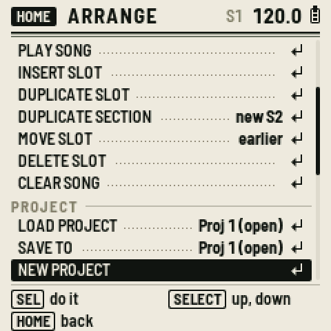

**4. The two lines at the bottom always say what each control does here.** Hold any button for a second and a card explains the page; let go and nothing changes. While it plays, the sequencer card on Steps and Bar flashes coral on each beat; Setup's list (**GLO**, then **SELECT** to Setup, **SEL**) has BEAT FLASH to turn it off (not tried). **Vermilion (the orange-red) means "now"**: the step that is playing, the tempo number while the song plays, the pump meter while it ducks.

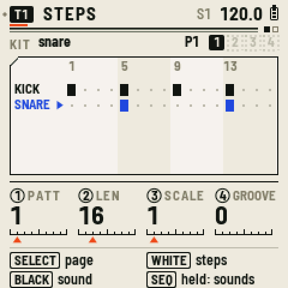 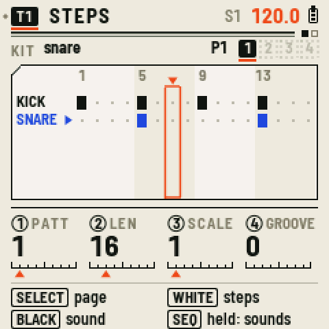
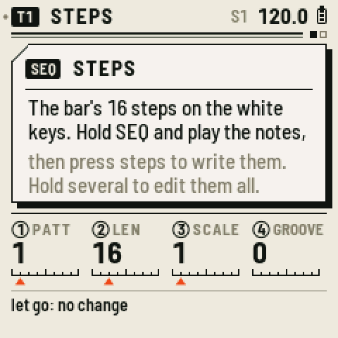

**5. Undo goes two steps back.** Hold **HOME**, press **REC**. Do it again for the change before that. A third time says NOTHING TO UNDO. Each message names what was undone ("UNDO T1 P4": track 1, pattern 4). Hold **HOME**, press **PLAY** to redo, once or twice.
Two quick edits of the same kind on the same pattern (within about a second) count as **one** undo step.

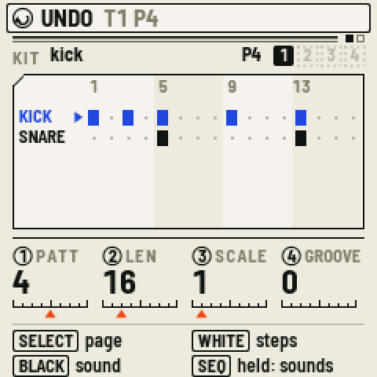 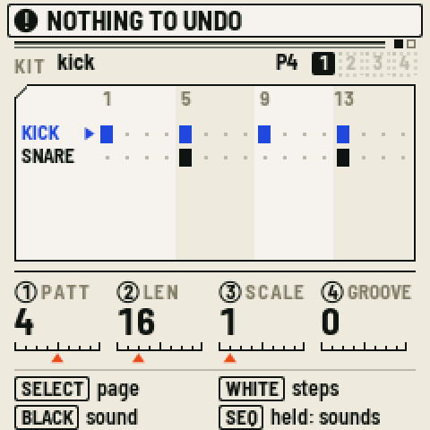

**6. Saving.** The project saves itself about three seconds after your last change, once everything is stopped. A small dot left of the page chip means "not saved yet", and **SAVE** is lit. Press **SAVE** to save at once. Hold **SAVE** and press white key 1, 2 or 3 to save into that slot.

---

## Chapter 1. A beat and a bass that pumps

**Sidechaining here is called pump.** A normal sidechain makes the bass get quieter every time the kick hits, then swell back. This firmware has two of them:

- **The master pump** (**GLO**, Master out). Every kick ducks every melodic track at once. Drums are never ducked, so the kick keeps its punch. It keeps working even if the kick is muted.
- **A track's own pump** (a track's **LFO**, type "pump"). It ducks only that track, and it is triggered by hits on a drum track you pick.

### Steps

1. **Start a new project.** Press **HOME**. Press **SEL**. Turn **SELECT** down to NEW PROJECT (about 13 clicks).
   
   Press **SEL**. The screen asks "NEW PROJECT?" Press **SEL** again for yes.
   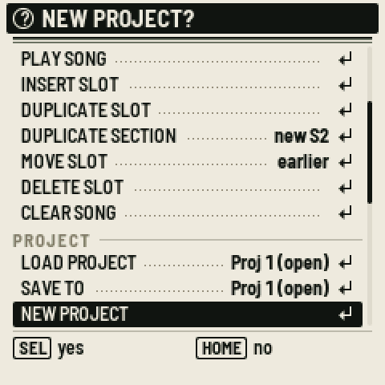
   Your saved projects are not touched. The new one goes into the first free slot. (With all three slots full it has no slot until you use SAVE TO, from the manual.)
   > **To start the song over but keep your sounds,** use CLEAR ALL PATTERNS instead: the row just below NEW PROJECT in the same list. It asks first (**SEL** yes). It empties every pattern, every scene and the song, and keeps the sounds, the mix and the pump. It cannot be undone: HOME+REC then says NOTHING TO UNDO. I checked this at the end of chapter 4.
2. **Check you are on T1.** After a new project the track is T1. If you are not sure, turn **ALGORITHM** until a page chip says T1 and the line under the header says KIT.
3. **Write the kick and snare.** Press **SEQ**. Press black key 1 (the top line says "kick"). Press white keys 1, 5, 9 and 13. Press black key 2 (snare). Press white keys 5 and 13.
   
   A black key picks the sound, a white key puts that sound on a step. Press the white key again and the sound comes off.
4. **Press PLAY.** The playhead runs along the steps in vermilion. Press **PLAY** again to stop.
   
5. **The bass.** Turn **ALGORITHM** to T2 (one click right). Press **EDIT**. Look at the top right: it should say BASS, then a number and a name. If it does not, turn **PRESETS** until it says BASS (any bass will do).
   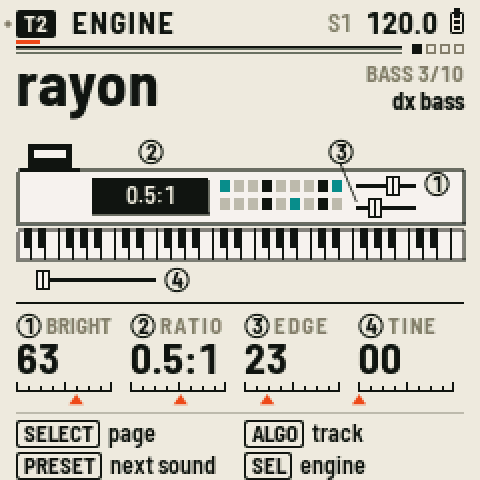
6. **Pick the note.** Press **SEQ**. Hold **SEQ** and press white key 5 (a C). Let go of both. The top line now shows the remembered note, C4.
   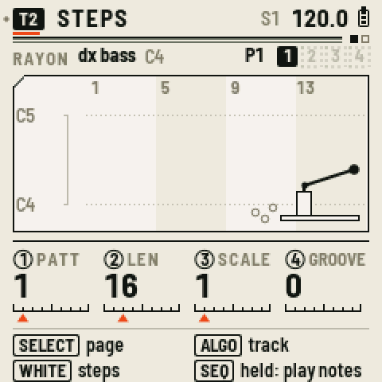
7. **Write it.** Press white key 1, then white key 9.
8. **Make each note last half a bar.** Hold white key 1 and press white key 8. Let go of both. The screen says LENGTH STEP 8. Hold white key 9 and press white key 16.
   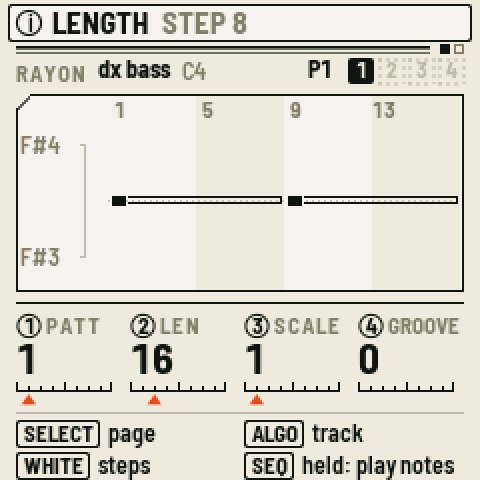
   Short notes give the pump nothing to duck. Long notes are the easy way to hear it.
9. **Press PLAY.** You hear kick, snare and a bass that holds still under them. This is the "before".
   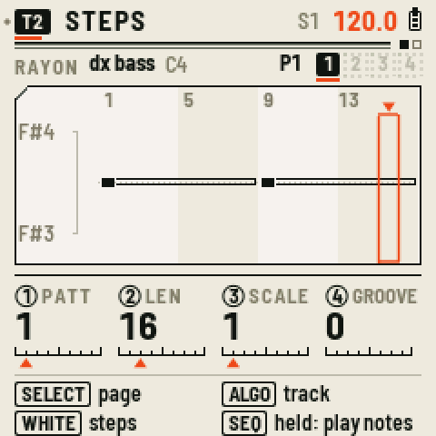
10. **Turn the master pump on.** While it plays, press **GLO**. This is the Mix page, with a meter for every track.
    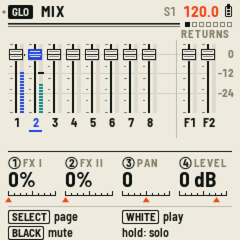
    Turn **SELECT** to MASTER OUT (3 clicks right: Master EQ, Master color, Master out). KNOB 4 says PUMP 0.0 dB (off).
    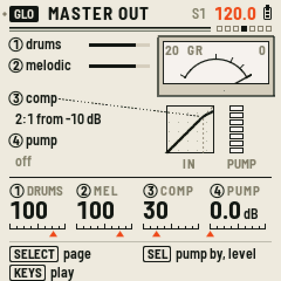
    Turn **KNOB 4** right until it reads **6.0 dB** (about 32 clicks).
    
    **What you should hear:** on every kick the bass drops, then swells back up before the next one. The kick, snare and any other drum do not drop. A red mark hangs from the top of the meter on the right while it ducks.
    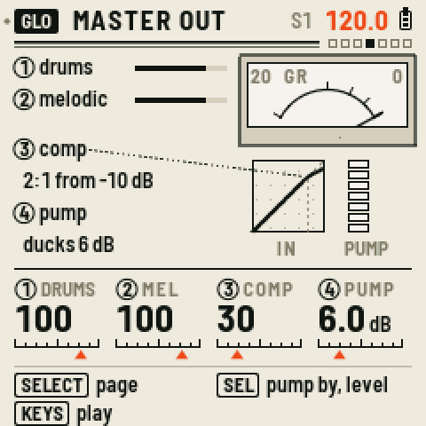
11. **Hear it on its own.** Turn **SELECT** back to Mix (3 clicks left). Hold black key 2 for about one second (a short press would only mute T2). Now only the bass sounds, and an **S** shows under T2.
    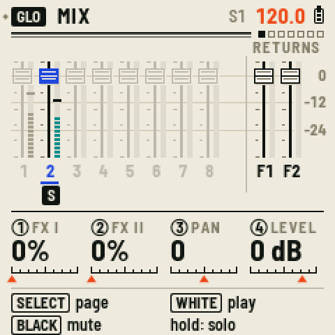
    The kick is silent but the bass still breathes in time with it. **A muted drum still drives the master pump.** Let go to hear everything again.
12. **Choose what drives it, and how fast it swells back.** Turn **SELECT** to Master out again. Press **SEL**. The list opens at its top row, FX I. Turn **SELECT** down to PUMP BY (about 15 clicks; it is a long list). It says **kick**.
    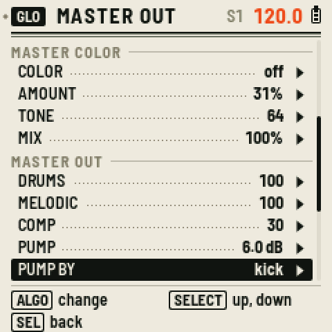
    Turn **SELECT** one row down to RELEASE. Turn **ALGORITHM** right until it reads about **235 ms** (20 clicks). Press **HOME** to close the list.
    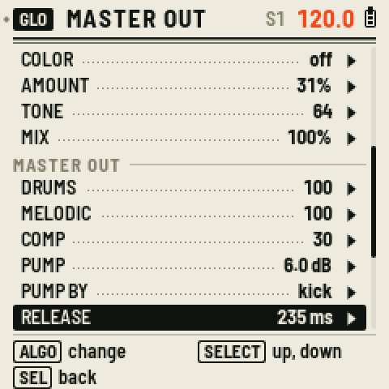
13. **Now the track's own pump.** First turn the master pump off so you hear one thing at a time: press **GLO**, turn **SELECT** to Master out, turn **KNOB 4** left until it reads 0.0 dB.
    Press **LFO** (you are still on T2). Turn **KNOB 1** right until TYPE reads **pump** (4 clicks from "off").
    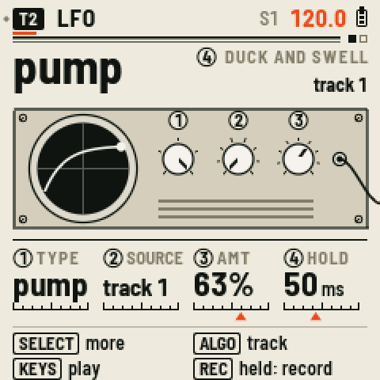
    The page is drawn as a small machine with a scope whose dot moves. The knobs under it are: TYPE, SOURCE (track 1: it listens to T1), AMT (how far the bass drops) and HOLD (how long it stays down before it swells). Turn **KNOB 3** right until AMT reads about **70%** (about 8 clicks).
    
    Turn **SELECT** one page right. **KNOB 1** is REL, the release. Turn it left until it reads about **160 ms**.
    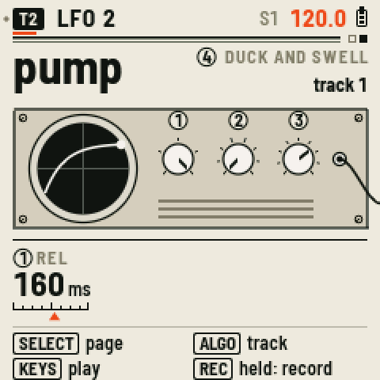
14. **Hear it.** Press **GLO**. Hold black keys 1 and 2 together for about a second. Only the kick and the bass sound, and the bass ducks on each kick.
    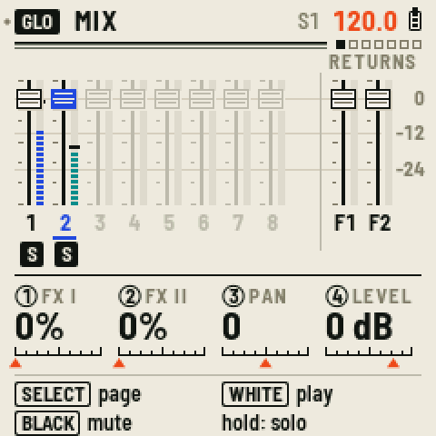
    Hold **both** keys. If you solo the bass alone, the kick is muted and the track pump does not move (see the box below).
15. **Keep one.** Press **LFO** and turn **KNOB 1** left until TYPE reads "off". Press **GLO**, turn **SELECT** to Master out, and turn **KNOB 4** right until it reads 6.0 dB. The master pump stays on for the rest of the tutorial.
    
16. Press **PLAY** to stop.

### How much is tasteful

These are starting points. Listen, then nudge.

| Setting | Gentle | Clear | Extreme |
|---|---|---|---|
| Master pump (KNOB 4 on Master out) | 2 to 4 dB: the mix breathes, you barely hear why | 5 to 8 dB: the classic house pump | 12 dB or more: the bass nearly disappears on each kick |
| Track pump AMT | 30 to 50% | 60 to 80% | 100% (the track goes silent on each hit) |
| Release (a beat is 500 ms at 120 BPM) | about 100 ms (the default is 107): it only nicks the kick's tail | 150 to 250 ms: a clear bounce | 500 ms or more: it never fully recovers before the next kick |

AMT is how far the track drops: at 50% it falls to half level (about −6 dB), at 70% to a third (about −10 dB). I measured the master pump on the simulator's audio output: at 12 dB the bass fell by about 12 dB on each kick, and the drums alone came out identical with the pump at maximum and at zero.

### How to hear the difference

- While it plays, turn **KNOB 4** on Master out to 0.0 dB and back. The bass goes from steady to breathing.
- Solo the bass (step 11). With the kick gone, you hear only the pump.
- Try a release of 500 ms or more. The mix cannot swell back before the next kick, so listen for a low, pulsing level instead of a bounce.

### What drives the pump

> **Heads-up: the two pumps are not the same.**
> - The **master pump** is keyed by the sequencer, not by sound. A muted kick still drives it (checked: it ducked with T1 muted).
> - The **track pump** only fires on **hits of a kit track**. It fires on **every** hit of the source track, not only the kick: if T1 had hats, the bass would duck on every hat too (checked: it ducked on every hat). That is why this beat has no hats on T1. A melodic track as the source does nothing (checked: no ducking). A **muted** kit does not drive it (checked: no ducking).

### Options

- **Pump by** (Master out, **SEL**, row PUMP BY, **ALGORITHM**): kick (any kick sound on any kit, the default), T1 to T8 (that track only; on a kit, its kicks, not its hats), metronome (nine clicks right of "kick"; the click drives it).
  - On a melodic track, "T2" means any note of T2 and it ducks **everything**, drums too (from the manual; I did not listen to this one).
- **Accent** (the row after RELEASE, **ALGORITHM** left for off): on, a soft hit ducks less. Off, every hit ducks fully.
- **Master level** (the last row): the output level, 100 is unity.
- **Track pump source** (T2, **LFO**, **KNOB 2**): track 1 to track 8, conductor, throws, metro. Only the kit tracks work in this build. "Metro" I did not try.
- **Track pump hold** (**KNOB 4**): how long it stays fully down before the release starts.
- **Both at once:** use a small master pump (3 dB) and a stronger track pump on the bass only.

### If it goes wrong

- Nothing ducks: Master out KNOB 4 is at 0.0 dB, or PUMP BY is not "kick".
- The track pump does nothing: LFO TYPE must read "pump", SOURCE must be a kit track that has hits, and that kit must not be muted.
- You are stuck in a list: press **HOME**.
- You changed the wrong thing: hold **HOME** and press **REC** to undo. Do it twice to go back two changes.

---

## Chapter 2. Basic chords

You will write a chord, change it, write four chords in a row, then let the conductor make the other tracks follow.

### A. Chords on a chord track

1. **Pick T3.** Turn **ALGORITHM** to T3 (one click right). Press **EDIT**. The label should be a sound that plays chords (CHORD, STAB, KEYS or PAD). If it is not, turn **PRESETS** until it is.
   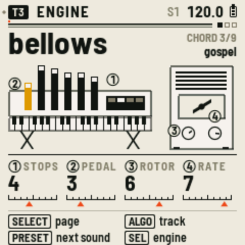
2. **Write a chord.** Press **SEQ**. Hold **SEQ**. Press white keys 5, 7 and 9 together (C, E, G), and hold them a moment. Let go of the keys, then of **SEQ**.
   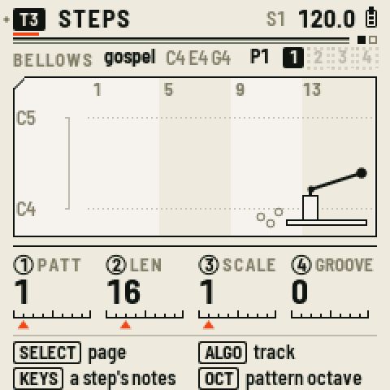
   The top line shows the chord you just played: C4 E4 G4. That is the "remembered notes".
   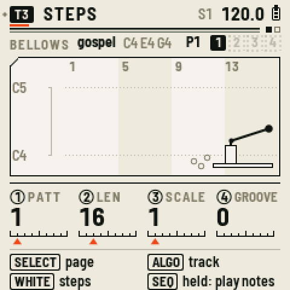
3. Press white key 1. The chord is on step 1.
   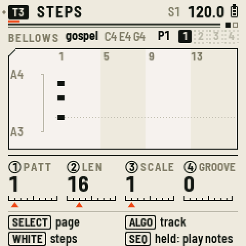
4. Press **PLAY**. You hear the chord once a bar. Press **PLAY** to stop.
5. **Make each step one beat.** Turn **KNOB 3** (SCALE) right until it reads **4** (3 clicks from 1). One step is now one beat, so the 16 steps are four bars.
   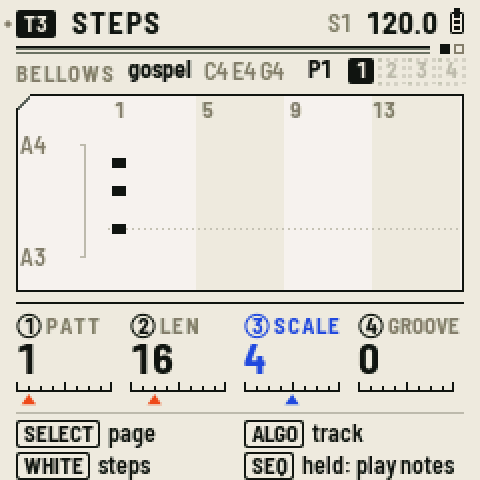
6. **Copy the chord.** Press white keys 5, 9 and 13. The remembered chord goes on each.
   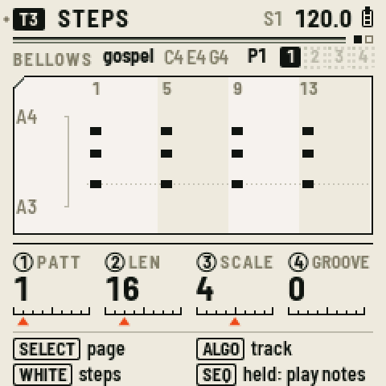
7. **Change step 5 to A minor.**
   - Hold white key 5. Tap **SEQ**. The screen says CHORD ON and shows the keys.
     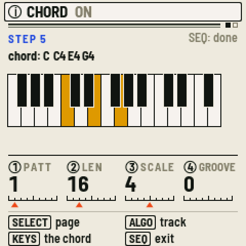
   - **Let go of white key 5.** (If you keep holding it, that key counts as a step, not a note, and your chord loses its C.)
   - Press white keys 3, 5 and 7 together (A, C, E). The screen names the chord: **Am**.
     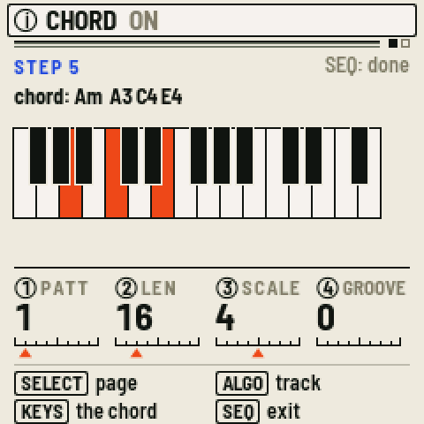
   - Let go. Tap **SEQ**. The screen says CHORD OFF. Length, tricks and locks on the step stay as they were.
8. **Step 9 becomes F.** Hold white key 9, tap **SEQ**, let go of white key 9. Press white keys 1, 3 and 5 together (F, A, C). Let go. Tap **SEQ**.
   **Step 13 becomes G.** Hold white key 13, tap **SEQ**, let go of white key 13. Press white keys 2, 4 and 6 together (G, B, D). Let go. Tap **SEQ**.
   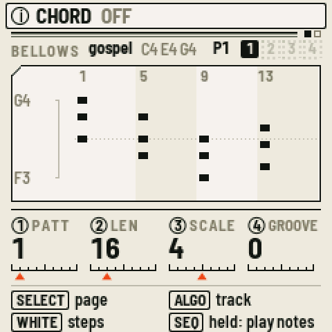
9. **Make each chord last a bar.** Hold white key 1 and press white key 4. Hold white key 5 and press white key 8. Hold white key 9 and press white key 12. Hold white key 13 and press white key 16.
   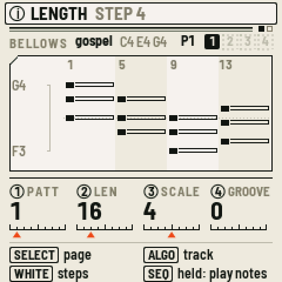
10. Press **PLAY** and listen for eight seconds. You hear C, Am, F, G, one a bar. The bass is still on C under all of them, so it clashes. Press **PLAY** to stop. The conductor fixes that.

### B. The conductor

The conductor holds a key, a scale and a chord. Tracks that follow it move their notes to match.

11. **Open it.** Turn **ALGORITHM** to COND (6 clicks right, past T8). Press **EDIT**. It shows the key (C), the scale (major) and the chord it hears.
    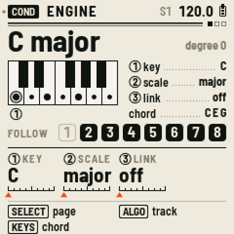
12. **Set the key and scale.** Turn **KNOB 1** right 2 clicks: the key becomes **D**. Turn it back 2 clicks. Turn **KNOB 2** right 1 click: the scale becomes **minor**. Turn it back.
    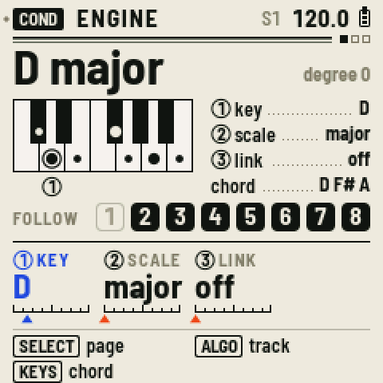 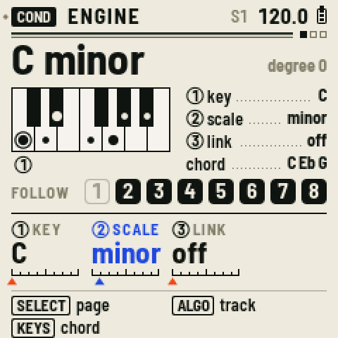
    The scales: major, minor, dorian, mixolyd, lydian, phrygian, harm min, penta, penta min, chrom. Keep C major for this song.
13. **Write the progression on the conductor.**
    - Press **SEQ**. Turn **SELECT** one page right (the Bar page). Press black key 4. The message says SCALE 4. Turn **SELECT** one page left (Steps).
    - Hold **SEQ**. Press white keys 5, 7 and 9 together. Let go of everything. Press white key 1.
    - Hold **SEQ**. Press white keys 3, 5 and 7 together. Let go. Press white key 5.
    - Hold **SEQ**. Press white keys 1, 3 and 5 together. Let go. Press white key 9.
    - Hold **SEQ**. Press white keys 2, 4 and 6 together. Let go. Press white key 13.
    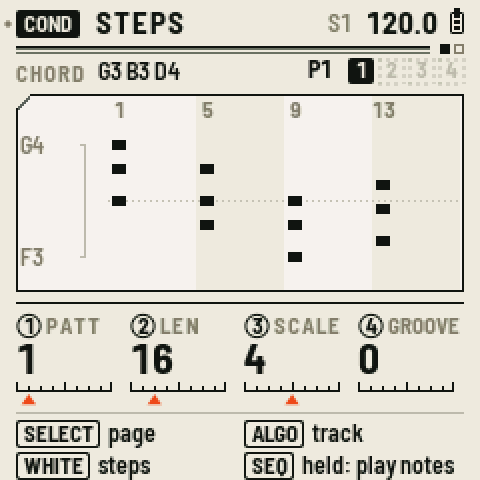
14. **Take T3 off the conductor.** Press **EDIT**. Turn **SELECT** one page right (the Play page). The numbers 2 to 8 are the tracks that follow.
    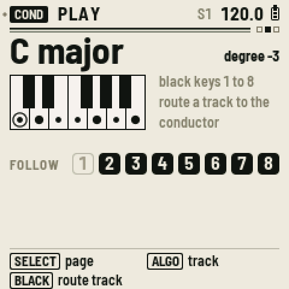
    Press black key 3. The message says "T3 ON ITS OWN" and its box goes pale.
    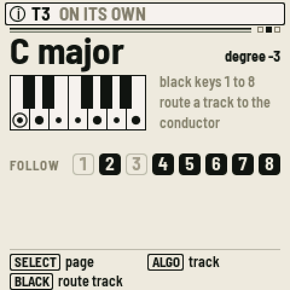
    > **Heads-up.** Every melodic track follows the conductor from the start, T3 too. T3 already plays full chords, so it would be moved a second time. I measured it: with T3 left on, bar 2 played F A C instead of A C E, and bar 3 played B D F.
15. Press **PLAY** and listen for eight seconds. The bass now walks with the chords: C, A, F, G. The chords play as written.
    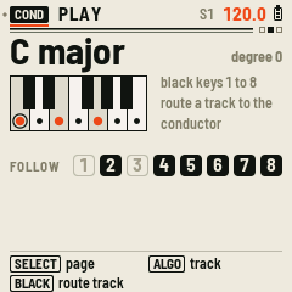
    What the simulator played in these four bars:

    | Bar | Chord | T2 bass | T3 chords |
    |---|---|---|---|
    | 1 | C | C4 | C4 E4 G4 |
    | 2 | Am | A3 | A3 C4 E4 |
    | 3 | F | F3 | F3 A3 C4 |
    | 4 | G | G3 | G3 B3 D4 |

    Press **PLAY** to stop.

### C. Follow modes, by what you hear

A follow mode is what a track does with its own notes when the conductor's chord changes. To hear the differences you need a line with a few different notes, so write one on T5. It becomes our lead.

16. Turn **ALGORITHM** to T5 (4 clicks left from COND). Press **SEQ**. Hold **SEQ**, press white key 12 (C5), let go. Press white key 1.
    Hold **SEQ**, press white key 14 (E5), let go. Press white key 5.
    Hold **SEQ**, press white key 16 (G5), let go. Press white key 9.
    Hold **SEQ**, press white key 14 (E5), let go. Press white key 13.
    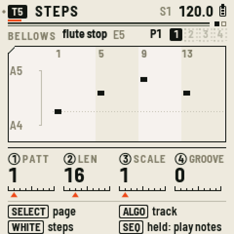
17. Press **PLAY** and listen to four bars (eight seconds). This is **diatonic**, the default. Press **PLAY** to stop.
18. **Switch modes.** Press **EDIT**. Press **SEL**. Turn **SELECT** down to FOLLOWS CONDUCTOR (about 6 clicks from the top row). It says diatonic.
    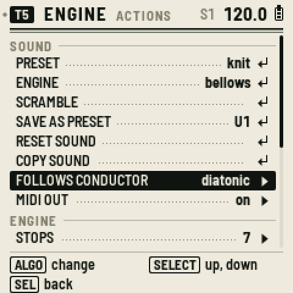
    Turn **ALGORITHM** one click right (transpose). Press **SEL** (closes the list). Press **PLAY**, listen for four bars, press **PLAY** to stop. Press **SEL** (the list opens on the same row). Turn **ALGORITHM** one more click (harmony). Press **SEL**, **PLAY**, listen, **PLAY**. Press **SEL**, one more click (ch. deg), **SEL**, **PLAY**, listen, **PLAY**.
    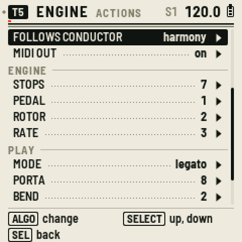
    When you are done, press **SEL**, turn **ALGORITHM** back to diatonic (3 clicks left) and press **SEL**.

What T5 played, from the simulator's MIDI out (the line you wrote is C E G E):

| Mode | Bar 1 (C) | Bar 2 (Am) | Bar 3 (F) | Bar 4 (G) |
|---|---|---|---|---|
| **diatonic** | C5 E5 G5 E5 | A4 C5 E5 C5 | F4 A4 C5 A4 | G4 B4 D5 B4 |
| **transpose** | C5 E5 G5 E5 | A4 **C♯5** E5 C♯5 | F4 A4 C5 A4 | G4 B4 D5 B4 |
| **harmony** | C5 E5 G5 E5 | C5 E5 A5 E5 | C5 F5 F5 F5 | B4 D5 G5 D5 |
| **ch. deg** | C5 G5 E5 G5 | A4 E5 C6 E5 | F5 C5 A5 C5 | G4 D5 B5 D5 |

What to listen for:

- **diatonic** (each note moves by the chord's degree, along the scale): you hear an arpeggio of each chord in turn: C, then A minor, then F, then G. The line keeps its shape and the chords keep their quality. **My recommendation for bass, pad and lead.**
- **transpose** (each note moves by the same number of semitones): the same, except every chord comes out **major**. In the Am bar the middle note is C♯, so you hear A major. Use it only for lines that do not need a third (root and fifth).
- **harmony** (each note snaps to the nearest chord note): the line barely moves. It stays near where you wrote it and just lands on chord notes, so it repeats notes (bar 3: C F F F). Good for a lead that should stay in the same register.
- **ch. deg** (the note's place in the scale picks the chord note): the line is re-ordered and leaps around, even in bar 1 (C G E G). A surprise generator.
- **no**: the track plays what you wrote (not measured).

### Options

- **Let a track lead the chords** instead of writing them on the conductor. Turn **ALGORITHM** to COND (4 clicks right from T5). Press **EDIT**. Turn **SELECT** two pages right (the Follow page). Press black key 3. T3's notes now set the chord for the others, and T3 follows nothing. Press black key 3 again to turn it off.
  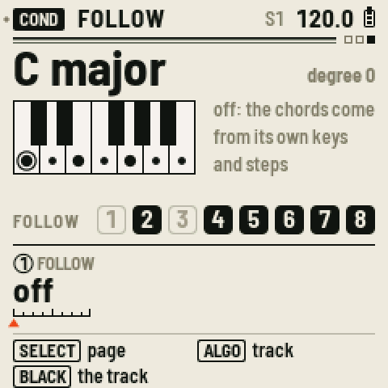 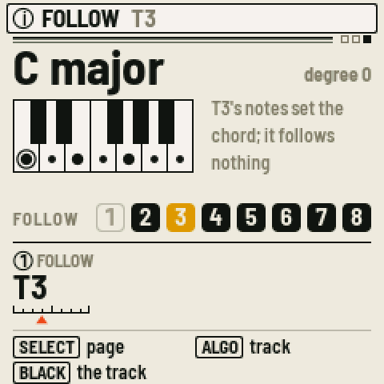
  This is quicker, but I measured one difference: with Follow, the bass takes the F **up** (F4); with the conductor's own steps it takes it **down** (F3). Turn **ALGORITHM** back to T5 (4 clicks left).
- **Change the key** of the whole song: COND, **EDIT**, **KNOB 1**. **KNOB 2** changes the scale. The conductor stores the key and scale with each scene (from the code; I did not try different keys in two scenes).
- **Per-track mode:** a track's **EDIT**, **SEL**, FOLLOWS CONDUCTOR (above). The Play page's black keys switch a track on and off (from the code: switching it back on sets it to diatonic).

### If it goes wrong

- A chord plays one note at a time: the track's sound is mono. **EDIT**, turn **SELECT** to the Play page, set MODE to poly (from the manual; I did not try it).
- A chord has a missing note: you kept the step key held when you played it. Redo step 7.
- A step has the wrong chord: hold the step, tap **SEQ** and replay it. A tap on a step that has notes clears it. Hold **HOME**, press **REC** brings it back (and once more goes one change further back).
- The chords sound wrong against the bass: check that T3 is "on its own" (step 14).

---

## Chapter 3. Layers

You will add a pad, a better lead, and a second drum track, then set effects and balance.

1. **Copy T3's chords.** Turn **ALGORITHM** to T3 (2 clicks left from T5). Press **SEQ**. Press **SEL**. Turn **SELECT** to COPY PATTERN (one row down).
   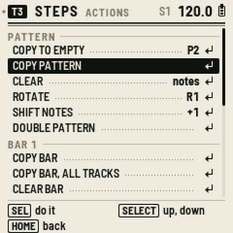
   Press **SEL**. The message says COPIED Pattern.
   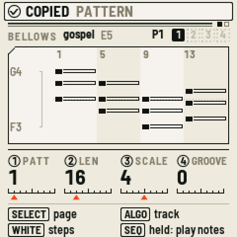
2. **Paste on a track of the same kind.** Turn **ALGORITHM** to T4, the pad (one click right). Press **EDIT**. The label should say PAD.
   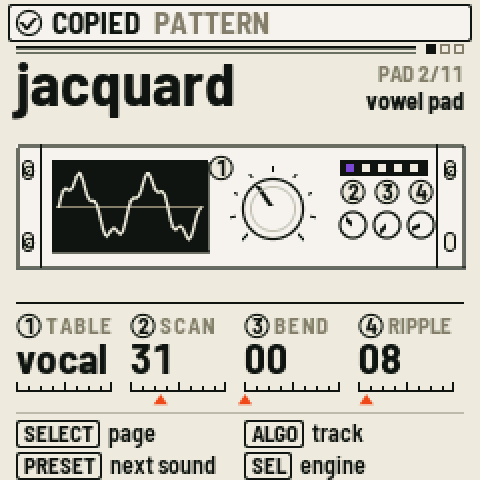
   Press **SEQ**. Press **SEL**. The list opens on COPY PATTERN. Turn **SELECT** to PASTE (one row down).
   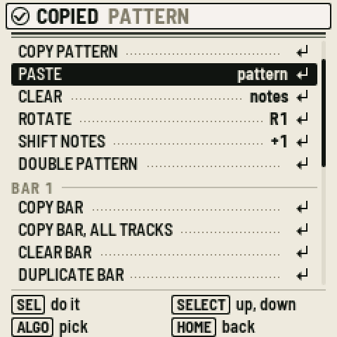
   Press **SEL**. The message says PASTED Pattern. The pad has T3's chords, their lengths and the scale.
   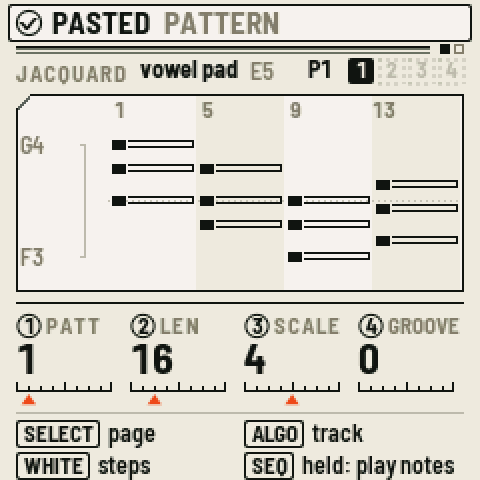
3. **Move it up an octave.** Hold **SEQ** and press **OCT+**. The message says OCTAVE UP T4 P1. Let go of **SEQ**. (**OCT−** moves it down.)
   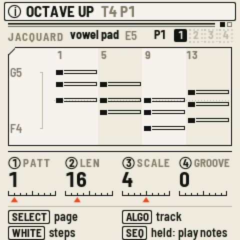
4. **Take T4 off the conductor**, for the same reason as T3. Turn **ALGORITHM** to COND (5 clicks right from T4). Press **EDIT**. Turn **SELECT** one page right (Play page). Press black key 4.
   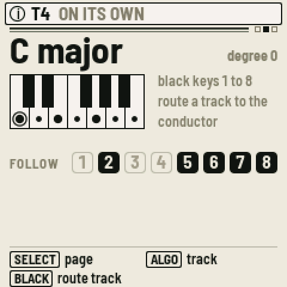
5. Press **PLAY**. You hear the bass, the chords, and the pad an octave above them, which fattens the chords. Press **PLAY** to stop.
6. **The lead.** Turn **ALGORITHM** to T5 (4 clicks left from COND). Press **EDIT**. Look at the big engine name and the four knobs. In my project T5 was a LEAD on the "bellows" engine, whose knobs (STOPS, PEDAL, ROTOR, RATE) have no unison. The **knit** engine has it: its knobs are WAVE, DETUNE, VOICES, WIDTH. If your T5 is not knit, switch it as below.
   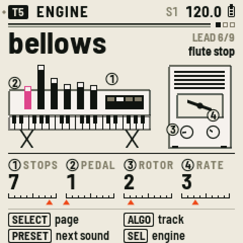
   Press **SEL**. The list opens on FOLLOWS CONDUCTOR (the row you used last in chapter 2). Turn **SELECT** up to ENGINE (5 clicks up). Turn **ALGORITHM** until the row reads **knit** (3 clicks left from bellows; the order of engines may change). Press **SEL**.
   
   
   The notes you wrote stay. Turn **PRESETS** until the label says **LEAD**. In my project that was LEAD 10/11 soft lead, 2 clicks left from the first sound (it wraps round the end of the list).
   
7. **Unison.** Press **PLAY**. While it plays, turn **KNOB 3** (VOICES) right until it reads 4 (3 clicks). Turn **KNOB 4** (WIDTH) right until it reads about 30, which spreads the voices across the stereo field. **KNOB 2** (DETUNE) sets how far apart the voices are tuned. The lead gets wider and thicker.
   
   I checked the voice count: with the lead playing, the simulator counted 8 voices at VOICES 1, and 11 at VOICES 4. Keep it at 2 to 4 voices and a detune of 10 to 25 for a thick, not seasick, sound. Leave it playing.
8. **A second drum track.** Turn **ALGORITHM** to T6 (one click right). Press **EDIT**. Press **SEL**. The list opens on ENGINE. Turn **ALGORITHM** until the row reads **kit** (5 clicks right from bellows). Press **SEL**.
   
   
   Press **SEQ**. Press black key 3 (hat). Press white keys 1, 3, 5, 7, 9, 11, 13 and 15.
   
   Hats on their own track keep T1 to kick and snare (the track pump from chapter 1 needs that). The master pump does not duck a kit, so T6 is not ducked, and its hats do not drive the pump (from the code: only kick sounds do).
   > **Option: let the machine write them (Euclid).** With the hat still the sound shown, press **SEL** and turn **SELECT** to EUCLID HITS (about 8 clicks down from PASTE, where the list opens). The row says "4 of 16": turn **ALGORITHM** to 5 and press **SEL**. The hat is now five hits spread evenly over the bar, and the message says EUCLID 5 of 16, TURN 0. The list reopens on the row, so **SEL**, **SEL** does it again. On a kit it only touches the sound shown. Hold **HOME**, press **REC** to undo it.
   >  
   > Next row down, **EUCLID ROTATE** turns the hits forward (it says "by 1" after one click of **ALGORITHM**, and the message says EUCLID 5 of 16, TURN 1). Turn it back to "by 0" afterwards: the row remembers its number. **VARY BAR** is the row after it: hits off the beat may drop or move a step and the velocities shift. The kick-beat steps 1, 5, 9 and 13 stay. It is different each time, and each press is one undo step.
   > 
   > On a synth track these fills write the note or chord you played last (from the manual; I only tried a kit).
9. **Sends.** There are two effects shared by all tracks: **FX I** (a delay) and **FX II** (a reverb). Each track sends some of its sound to them. Turn **ALGORITHM** to T4, the pad (2 clicks left). Press **FX**. Turn **SELECT** one page right: the Sends page. Turn **KNOB 2** right until it reads about **45%**.
   
   Turn **ALGORITHM** to T5 (one click right). Turn **KNOB 1** (FX I, the delay) right until about **30%**. Turn **KNOB 2** (FX II) right until about **20%**.
   
   Turn **SELECT** one page right: **FX I**, the delay. Turn it again: **FX II**, the reverb. On these two pages **PRESETS** picks the effect (chorus, delay, lofi, phaser; the reverb has eleven modes).
    
10. **Balance.** Press **GLO** (Mix). **KNOB 4** is the level of the lit strip, and **ALGORITHM** picks the strip. T5 is lit: turn **KNOB 4** left until about −3 dB (10 clicks). Turn **ALGORITHM** to T3: **KNOB 4** left to about −6 dB (20 clicks). Turn **ALGORITHM** to T4, the pad: **KNOB 4** left to about −9 dB (30 clicks). Turn **ALGORITHM** to T6, the hats: **KNOB 4** left to about −6 dB (20 clicks).
    
11. **Mute and solo.** Tap black key 6 (hats). The message says MUTED T6 and an **M** shows under the strip. Wait a second and tap it again to bring them back.
    
    Hold black key 4 for about a second: only the pad sounds. Let go and everything is back.
    
    > **Heads-up.** Two quick taps on a black key are a **solo that stays** (SOLO STAYS), not mute and unmute. Wait a second between taps. Tap any strip's black key on Mix to end it.

Leave it playing and listen: a four-bar loop with five layers.

### Options

- **A second sound on one drum step:** on T1 Steps, hold a step and press another black key (hold white key 3, press black key 3: a hat on step 3). Undo with hold **HOME**, press **REC**.
- **Per-track pan:** Mix, **KNOB 3**.
- **Solo that stays:** two quick taps on a black key (above).
- **Octave down:** hold **SEQ**, press **OCT−** (from the manual; I only tried **OCT+**).

### If it goes wrong

- A paste does nothing or says "CAN'T PASTE ON A KIT": a synth pattern will not paste onto a kit (checked), and the manual says a kit's steps paste only onto a kit. Paste onto a track of the same kind.
  
- The pasted chords sound wrong against the conductor: put that track "on its own" (step 4).
- No unison: that engine has no voices knob. Switch to knit (step 6).
- A strip stays silent: it is muted, or another strip is soloed.
- Undo: hold **HOME**, press **REC**; again for a second step back. Two quick edits of the same kind count as one.

---

## Chapter 4. Song structure

Everything so far is one scene. A song is a chain of scenes.

- A **scene** is "which pattern each track plays", plus the mutes and the conductor's key. It is the sections of your song.
- The **song** is a list of slots. Each slot plays one scene for a number of bars.

Three ways to get a new or repeated section, in two lines:

- **NEW SECTION** (HOME's list): a new scene made from the scene that is playing, with its own copy of every pattern. It is not in the song until you add it.
- **DUPLICATE SECTION** (Song page's list): a new scene made from a song slot's scene, with its own patterns, inserted as the next stop. **DUPLICATE SLOT** inserts the *same* scene again, so an edit to the repeat changes both.

### Steps

1. **Stop** with **PLAY**. Press **HOME**. This is Arrange: each row is a track and the pattern it plays. The big number is the scene (1). The white keys are scenes 1 to 16.
   
2. **Make a new section.** Press **SEL**. In chapter 1 the last row you used in this list was NEW PROJECT, a destructive row, so the list now opens on its first row, **NEW SECTION**. (Older builds opened on NEW PROJECT; this one cannot.)
   
   Press **SEL**. The message says "NEW S2 ITS OWN PATTERNS" and the big number is 2.
   
   S2 plays **copies** of the patterns, in P2 on each track that has notes. Edit S2 and S1 stays as it was. T7 and T8 have no notes, so they keep playing P1 in both scenes.
   > **What "shared" means.** If two scenes play the same pattern, an edit in one changes both. That is what the manual says an empty scene key does: a new scene that shares every pattern. NEW SECTION makes real copies instead. Tracks with no notes share silently (T7 and T8 here). A track **that has notes** shares only when it could not be copied: no empty pattern is left among its eight, or no room for its locks. Then the message says "N TRACK STILL SHARED". I forced this case: with T2's eight patterns all full, NEW SECTION said "NEW S2 1 TRACK STILL SHARED", and a note written on T2 in S2 appeared in S1 too.
   
3. **A breakdown by muting.** Press black key 1. Wait a second. Press black key 2. T1 and T2 are muted **in this scene**.
   
   Press white key 1: scene 1, with no mutes. Press white key 2: back to scene 2, mutes included. Press **PLAY**. You hear the chords, the pad, the lead and the hats, but no kick or bass. The pad and chords still breathe, because the muted kick still drives the master pump (checked). Press **PLAY** to stop.
   
   > Wait a second between the two black key presses; two quick taps are a solo.
4. **A section with a fill.** Press white key 1 (scene 1). Press **SEL**. The list opens on NEW SECTION (the row you used last). Press **SEL**. The big number is 3.
   
   This scene is where we use the bar copy. Every track has a one-bar pattern (16 steps) except the chord tracks, which hold four bars (scale 4). **COPY BAR, ALL TRACKS** copies "the 16 steps shown" on every track.
   Press **SEQ** (T1 is selected). Press **SEL**. The list opens on the row you used last in a Steps list (PASTE if you skipped the Euclid option in chapter 3, VARY BAR if you did). Turn **SELECT** to COPY BAR, ALL TRACKS (5 clicks: down from PASTE, up from VARY BAR). Do not press **SEL** on a row you did not mean to.
   
   Press **SEL**. The message says COPIED Bar 1, all tracks.
   
5. Press **OCT+**. Bar 2 shows, hatched, because the pattern is only one bar long.
   
   Press **SEL**. The list opens on COPY BAR, ALL TRACKS. Turn **SELECT** one row down to PASTE BAR, ALL TRACKS.
   
   Press **SEL**. The message says "PASTED BAR 7 TRACKS" (T1 to T6 and COND). Every pattern in S3 is now 32 steps. The drums have two identical bars; the chord tracks hold the progression twice (eight bars).
   
   S1 keeps its 16-step patterns, because S3 had its own copies.
6. **Write the fill in bar 2.** Bar 2 is on screen. Press black key 2 (snare). Press white keys 14, 15 and 16. Step 29 already has a snare, and pressing it again would take it off.
   
   > **Or let the machine vary the bar:** press **SEL**, turn **SELECT** to VARY BAR (the row after EUCLID ROTATE) and press **SEL**. Hits off the beat may drop or move. It is different every time; hold **HOME**, press **REC** to undo it and try again. I checked it on the hats and on the snare.
7. **The Song page.** Press **HOME** (Arrange). Turn **SELECT** one page right: Song. It is empty.
   
   Press white key 1. A stop appears: scene 1 for 4 bars. Press white key 2, then white key 3, then white key 1. Each key adds that scene after the selected slot, with as many bars as the slot before it.
   
   The map shows each slot as a stop with a section letter, and a tick for each bar. The first scene is A, the next new one is B, and a scene that comes back keeps its letter.
8. **Bars per slot.** Turn **KNOB 1** to slot 2 (2 clicks left; scene 2, the breakdown). Turn **KNOB 3** left to **2 bars** (2 clicks). The song is now 14 bars.
   
9. **Move a slot.** Listen first: press **SEL**. The Song page's list has its own last row, and nothing used yet, so it opens on the first row, **PLAY SONG**. **Do not press SEL on it** (it would start the song). Turn **SELECT** down to MOVE SLOT (about 4 clicks). Turn **ALGORITHM** one click right: "later". Press **SEL**. The message says MOVED to slot 3: the breakdown now comes after the fill section.
   
   
10. **Loop or stop.** Turn **KNOB 4** one click left for **stop**. The map shows "end" where it was "back to A". (Right is loop.)
    
11. **Repeat a section with a change: DUPLICATE SECTION.** Turn **KNOB 1** one click right: slot 4, the last A. Press **SEL**. The list opens on MOVE SLOT (the row you used last); **DUPLICATE SECTION** is the row above it. Turn **SELECT** up one row. The row says "new S4". Press **SEL**.
    
    The message says DUPLICATED NEW S4, and the song has a fifth stop, scene 4, with the same number of bars. The new scene has its own copy of every pattern (checked: T1 to T6 each got P4, T7 stays on P1). Nothing switches.
    
    Now change the repeat without touching the original. Press **HOME**. Press white key 4 (scene 4). Turn **ALGORITHM** to T6 (5 clicks right from T1). Press **SEQ**. Press black key 3 (hat). Press **SEL**. The list opens on PASTE BAR, ALL TRACKS (the row used last). Turn **SELECT** to EUCLID HITS (3 rows down). It says "5 of 16" (a row remembers its last number: on a fresh row it says "4 of 16" and one click of **ALGORITHM** makes 5). Press **SEL**. The message says EUCLID 5 of 16, TURN 0.
    
    
    Scene 1's hats are still on every other step (checked).
12. **Play the song.** Press **HOME**. Turn **SELECT** one page right (Song). Turn **KNOB 1** to slot 1 (4 clicks left). Press **PLAY**. It plays slot 1 (scene 1, four bars), then the fill section (four bars), then the breakdown (two bars, no kick and no bass), then scene 1, then scene 4 with the changed hats, then it stops. A small red train runs along the map.
    
    
    I checked the timing in the simulator: slot 2 starts at 8 seconds, slot 3 at 16, slot 4 at 20, slot 5 at 28, the end at 36. Each slot starts its patterns again from step 1: the chords began on C each time, and the 2-bar breakdown played only C and Am.
13. **Save.** Change something (**KNOB 4** one click right, back to loop). A small dot appears left of the page chip.
    
    Press **SAVE**. The message says SAVED.
    
    I switched the simulated FM-1 off and on after this: the song (slots, bars), the scenes and the patterns all came back.
    To save into a slot: hold **SAVE** and press white key 1, 2 or 3.
    

### Options

- **Switch scenes while it plays:** press **HOME**, then a scene's white key. The screen says "next bar", and it switches there (checked). Pressing the key again switches at once (from the manual; I did not try it).
- **PLAY SONG:** on the Song page press **SEL**, turn **SELECT** to PLAY SONG (the first row), press **SEL**. It plays from the top whichever slot is selected (checked).
- **DUPLICATE SLOT** (Song page's **SEL** list, the row above DUPLICATE SECTION): repeats the selected slot with the *same* scene (checked: the song grows by one stop). **DELETE SLOT** (the row below MOVE SLOT) removes the selected slot. A song cannot be edited while it plays (the screen says "STOP FIRST").
- **Undo a DUPLICATE SECTION or a NEW SECTION:** hold **HOME**, press **REC**. The new scene and the stop are gone (checked).
- **Start the song over but keep your sounds:** CLEAR ALL PATTERNS (HOME's list, the row below NEW PROJECT; about 14 clicks from the top row). Turn **SELECT** up to the top first if the list opened low: it does not wrap. The screen asks "CLEAR ALL PATTERNS?" (**SEL** yes). Every pattern, scene and the song are empty; the sounds, the mix, the pump and the conductor routing stay. It cannot be undone.
    
- **Press an empty scene's white key** (from the manual; I did not try it): a new scene that is a copy of the playing one and shares every pattern. For a variation, use NEW SECTION instead.
- **Hold a white key for a second** to clear that scene (from the manual; I did not try it).
- **Another scene or bar count:** KNOB 2 on the Song page changes the selected slot's scene; KNOB 3 its bars (1 to 64).

### If it goes wrong

- **NEW SECTION or DUPLICATE SECTION went wrong:** hold **HOME**, press **REC**. The scene goes away, and the song and scenes are as before.
  
- **You deleted or cleared something small:** hold **HOME**, press **REC** (twice for two steps). **CLEAR ALL PATTERNS** cannot be undone: HOME+REC says NOTHING TO UNDO.
- The list opened on the wrong row: the list remembers its last row, except after a destructive row, where it opens on its first row. Read the highlighted row, then move.
- "STOP FIRST": press **PLAY** to stop, then change the song.
- You are in a list: press **HOME**.

---

## Cheat sheet

**Moving around**

| To do this | Press |
|---|---|
| Pick a track | Turn **ALGORITHM** |
| Steps / next page | **SEQ**, then **SELECT** (Bar page: black key 4 sets scale 4) |
| Sound pages | **EDIT** (Engine), **ENV**, **FX** (Character, Sends, FX I, FX II), **LFO** (pump, page 2 release), **ARP** |
| Mix | **GLO**, then **SELECT** to Master out |
| Arrange / Song | **HOME**; then **SELECT** one page right |
| Open a list / back out | **SEL** / **HOME** |
| Change a list row / do it | **ALGORITHM** / **SEL** |
| Undo (two steps) / redo | Hold **HOME**, press **REC** (again for the second) / **PLAY** |
| Save / save to a slot | **SAVE** / hold **SAVE**, white key 1 to 3 |
| Help card | Hold any button for a second |
| Play / stop | **PLAY** |

**Steps and chords**

| To do this | Press |
|---|---|
| Write a drum hit | **SEQ**, a black key, then white keys |
| Take it off | Press the same white key again |
| Pick a note or chord | Hold **SEQ**, play it, let go |
| Put it on a step | Press that step's white key |
| Make a note longer | Hold the step, press a later white key |
| Change a chord | Hold the step, tap **SEQ**, let go of the step, play the chord, tap **SEQ** |
| One step = one beat | **KNOB 3** to 4 |
| Move a pattern an octave | Hold **SEQ**, press **OCT+** or **OCT−** |
| Copy / paste a pattern | **SEQ**, **SEL**, COPY PATTERN; another track, **SEL**, PASTE |
| Copy / paste a bar on all tracks | **SEL**, COPY BAR, ALL TRACKS; **OCT+** for the bar; **SEL**, PASTE BAR, ALL TRACKS |
| Add a second sound to a drum step | Hold the step, press a black key |
| Spread N hits evenly over a bar | Pick the sound (black key), **SEL**, EUCLID HITS, **ALGORITHM** to N, **SEL** |
| Turn the hits forward / vary the bar | **SEL**, EUCLID ROTATE (**ALGORITHM**, **SEL**) / VARY BAR (**SEL**). **SEL** **SEL** repeats |

**Conductor**

| To do this | Press |
|---|---|
| Set key / scale | COND, **EDIT**, **KNOB 1** / **KNOB 2** |
| Write a progression | COND, **SEQ**, hold **SEQ**, play the chord, let go, press the step |
| A track plays on its own | COND, **EDIT**, **SELECT** (Play page), the track's black key |
| A track leads the chords | COND, **EDIT**, **SELECT** twice (Follow page), the track's black key |
| Follow mode of a track | Track, **EDIT**, **SEL**, FOLLOWS CONDUCTOR, **ALGORITHM** |

**Pump and mix**

| To do this | Press |
|---|---|
| Master pump | **GLO**, **SELECT** to Master out, **KNOB 4** |
| What drives it, release, accent | Master out, **SEL**, PUMP BY / RELEASE / ACCENT, **ALGORITHM** |
| Track pump | Track, **LFO**, **KNOB 1** to pump; **KNOB 2** source, **KNOB 3** amount, **KNOB 4** hold; **SELECT** release |
| Level of a strip | **GLO**, **ALGORITHM**, **KNOB 4** |
| Sends | **FX**, **SELECT** once; **KNOB 1** FX I, **KNOB 2** FX II |
| Mute / solo | **GLO**, tap a black key / hold it a second |
| Change a track's engine | Track, **EDIT**, **SEL**, ENGINE, **ALGORITHM**, **SEL** |
| Sound presets | Track, **EDIT**, **PRESETS** |

**Scenes and the song**

| To do this | Press |
|---|---|
| New section (from the playing scene) | **HOME**, **SEL**, NEW SECTION, **SEL** |
| Switch scene | **HOME**, a white key |
| Mute a track in this scene | **HOME**, its black key (wait between keys) |
| Add a slot | Song page, a white key |
| Slot / scene / bars / loop | **KNOB 1** / **KNOB 2** / **KNOB 3** / **KNOB 4** |
| Repeat a slot with a changeable copy | Song page, slot, **SEL**, DUPLICATE SECTION, **SEL** |
| Repeat a slot, same scene | **SEL**, DUPLICATE SLOT, **SEL** |
| Move a slot | **SEL**, MOVE SLOT, **ALGORITHM**, **SEL** |
| Play the song | **PLAY** on the Song page (from the slot), or **SEL**, PLAY SONG (from the top) |
| New project | **HOME**, **SEL**, NEW PROJECT, **SEL**, **SEL** |
| Start over, keep sounds and mix | **HOME**, **SEL**, CLEAR ALL PATTERNS, **SEL**, **SEL** (no undo) |

---

## What I could not check

- **How anything sounds.** I checked values and the notes the simulator sends, and measured levels from its audio output for the pump. The "what you should hear" lines are descriptions to listen for.
- **Metronome as the pump source**, **pump by a melodic track**, **MODE poly**, **hold a scene key to clear it**, **Euclid and VARY on a synth track**, **an empty scene key**, **OCT−**: from the manual or the code only.
- **Knob click counts** (such as "32 clicks") are the simulator's one-value-per-click. On the device a fast turn may jump further. Go by the number on the screen.
- **List click counts** are hints from the simulator. Go by the row name.
- **A real power-off.** The simulator's reboot keeps the list memory that a real power-off clears, so after a real restart every list opens on its first row.
